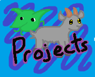

<h2>Hi, I am Greg!</h2>

<h4><em>Real Time Interactive Simulation student at Digipen Institute of Technology</em></h4>
<h6>Gaps in my Github History is caused by me using perforce for certain projects</em></h6>

### Socials!

### More about me! 
- I aspire to be a game developer, actively working with some part of the process of game development to achieve that.
- As of 2026, I am currently looking for internships!
- I am interested in Cyber Security.
- God fearing american.

### Learn more about my Projects!

  <h1 align="center">$\color{red}{\textsf{\textbf{Real image of me}}}$</h1>

  

